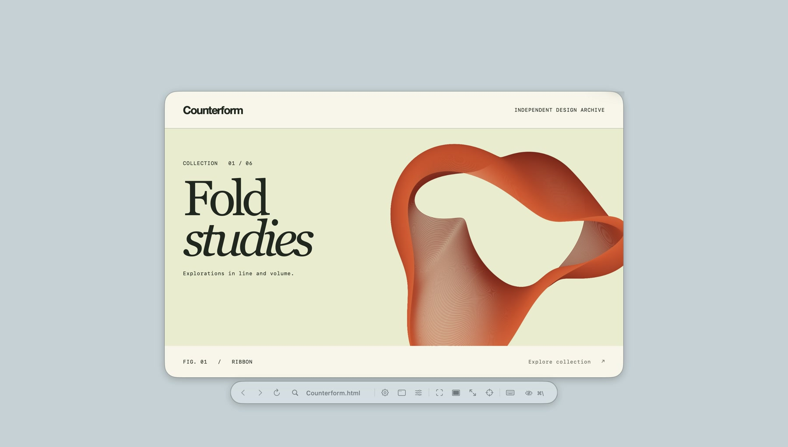
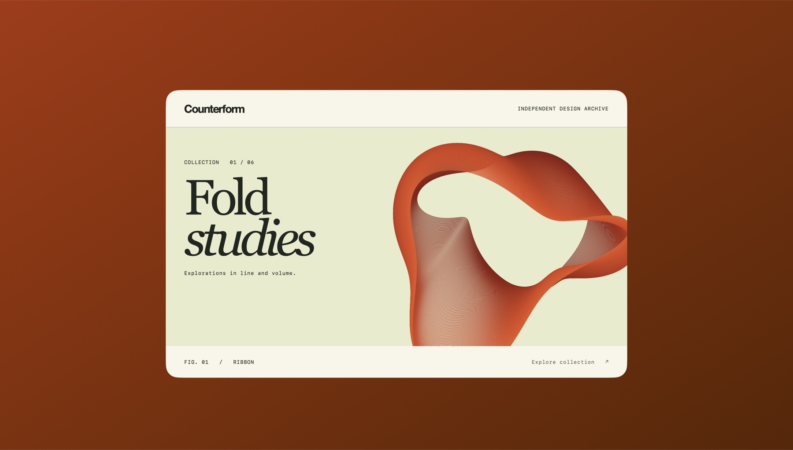

# Brow

Brow is a macOS browser for presenting interactive prototypes. Set the viewport to the size you designed for, choose WebKit or Chromium for each tab, and hide the controls when you’re ready to present.



## Navigate from the pill

The address field shows the current hostname, including the port for local demos. Click it to select the full URL. Type an address or search term and press **Return** to navigate, or **Esc** to cancel. Back, Forward, and Reload sit beside the field. The history arrows dim when there’s nowhere to go in that direction.

Press **⌘L** to open the larger address and tab palette, even while the pill is hidden. Type part of an open tab’s title or URL, then use the arrow keys and Return to switch to it.

## Set the frame

Brow opens centred at **1200 × 800 points**, or as large as the display allows. Click the resize icon in the floating toolbar to set the width, height, and position. Drag the **Width** and **Height** sliders, or click a slider to jump near a tenth of the range. You can also type a number, and a number that is larger than the screen snaps to the screen size. Edits take effect as you type, so you can find a responsive breakpoint while the prototype is running. Press **⌥⌘C** to centre the result. Drag near the top edge, or hold **Option** and drag anywhere on the page.

## Present at that size

Press **⇧⌘F** for **Focus mode**. Brow gives the presentation its own full-screen Space while keeping the page centred at your chosen dimensions. A gradient drawn from the visible page slowly settles around it. For a consistent background across demos, choose a solid colour in **Settings → Window**. Press **⌘ + backslash** to hide the toolbar, and **⇧⌘F** again to return to your original window.



## Show one page in many viewports

Click the devices icon in the floating toolbar and select the viewports that you want: **iPhone**, **iPhone Duo**, **iPhone Duo, open**, **iPad** or **Desktop**. Brow opens the page one time for each viewport and puts the copies in a grid. The Brow window becomes an invisible frame for the grid, and each copy looks like a separate window with its own shadow. A label below each copy gives the name and the size of its viewport. Each copy lays out at the full size of its viewport, then scales, with its content, to fit the window. The copies in a row have the same top and bottom edges, each row has the same width, and each copy keeps its aspect ratio. Resize the window to change the size of the grid. To change the order, drag a label. The copy moves with the pointer, and a blue line shows where it will go when you release it.

Each copy scrolls independently. When you follow a link in one copy, the other copies go to the same address. To keep the copies independent, clear **Follow links in all viewports** in the same menu. The address field, Back, Forward and Reload apply to all the copies. Clear all the selections to go back to one page that fills the window. Apple does not publish the point sizes of the iPhone Duo displays, so those two sizes are estimates from its pixel sizes.

## Compare WebKit and Chromium, tab by tab

Open the same prototype in two tabs. In **Settings → Browser**, set **Current tab** to Chromium for one and WebKit for the other. Use **⌘1** and **⌘2** to switch between them at the same window size. Changing engines reopens the URL. Each engine has its own cookies and site storage, so a signed-in demo may need signing in twice.

WebKit is the default for new tabs. You can change that default in the same panel. Brow loads its bundled Chromium Embedded Framework when you first open a Chromium tab.

## Keyboard controls

| Action | Shortcut |
| --- | --- |
| Open the address and tab palette | ⌘L |
| Choose a matching tab in the palette | ↑ or ↓, then Return |
| Cancel an address edit or dismiss the palette | Esc |
| Open or close a tab | ⌘T / ⌘W |
| Switch to a numbered tab | ⌘1–9 |
| Go back / forward | ⌘[ / ⌘] |
| Reload | ⌘R |
| Toggle the toolbar | ⌘ + backslash |
| Centre the window / fill the usable screen | ⌥⌘C / ⌥⌘F |
| Toggle Focus mode / regular full screen | ⇧⌘F / ⌃⌘F |
| Open Settings | ⌘, |

## Build and run

Brow runs on Apple silicon Macs. Install Rust and the Xcode command line tools, then run the following from the repository root.

```sh
scripts/build-app
open target/Brow.app
```

The first build downloads the pinned Chromium distribution and verifies its digest. Later builds reuse the local copy. You can move the self-contained app bundle to Applications. For a WebKit-only development run, use `cargo run`.

Rust manages tabs and navigation. AppKit draws the window, palette, and toolbar. The [Gecko experiment](experiments/gecko) tracks work on Firefox engine integration.

### Native integration checks

```sh
BROW_UI_TEST=1 scripts/build-app
target/ui-test/Brow.app/Contents/MacOS/Brow --use-mock-keychain
target/ui-test/Brow.app/Contents/MacOS/Brow --use-mock-keychain -TestReduceMotion YES
target/ui-test/Brow.app/Contents/MacOS/Brow --use-mock-keychain -TestViewports webkit
target/ui-test/Brow.app/Contents/MacOS/Brow --use-mock-keychain -TestViewports chromium
```

The checks use a separate app bundle and exercise page loading in both engines, keyboard navigation, interrupted tab transitions, and shutdown.

### Versions and releases

The version in `Cargo.toml` is the only source. `scripts/build-app` writes it into the app bundle, so Finder shows it in **Get Info**. To make a release, give the new version to the release script.

```sh
scripts/release 0.2.0
git push origin HEAD v0.2.0
```

The script sets the version in `Cargo.toml` and `Cargo.lock`, commits the change, and adds the annotated tag `v0.2.0`. It does not build the app. Local builds have an ad hoc signature, so a tag does not have an app download attached.

### No code comments

Code comments are not permitted. `cargo test --test no_comments` fails when a tracked source file has more comment lines than `tests/comment-baseline.txt` allows. Decisions that the code cannot show are in [docs/adr](docs/adr).
