# Brow

A macOS browser for Apple silicon. Rust owns the tabs and navigation policy.
AppKit provides the window, address palette, menus and rendering surfaces.
WebKit is the default. Chromium runs through the bundled Chromium Embedded
Framework (CEF), loaded when the first Chromium tab opens.

## Build and run

Install Rust and the Xcode command line tools, then run:

```sh
scripts/build-app
open target/Brow.app
```

The first build downloads the pinned Chromium distribution and checks its
digest. Later builds use the local copy. The app bundle is self-contained and
can be moved to Applications. A plain `cargo run` runs the WebKit shell without
the bundled Chromium engine.

Brow opens centred at 1200 × 800 points, scaled down along either dimension
when the display has less room. The glass toolbar sits below the page, moving
inside its lower edge when space is tight. Its sliders open a live size and
position editor, and the keyboard icon lists Brow’s shortcuts.

## Keyboard

- **⌘\** hides or shows the toolbar. **⌥⌘C** centres the window and **⌥⌘F** fills the usable screen.
- **⌘L** opens the address palette with the current URL selected. Type a URL
  or search term and press Return. Type part of a tab title or URL, then use
  the arrow keys and Return to switch. Escape returns to the page.
- **⌘T**, **⌘W** and **⌘1–9** open, close and switch tabs.
- **⌘[**, **⌘]** and **⌘R** go back, go forward and reload.
- **⌘,** opens Browser, Window, and Icon settings. Click an icon to change the
  Dock icon immediately. Switching the current tab's engine reopens its URL
  with the selected engine's cookies and site storage.
- **Settings → Window** accepts width, height, left and top in macOS points,
  relative to the usable area of the current screen. Valid edits update the window
  live. Tab and Shift-Tab move between fields. **Centre on screen** repositions it immediately.
- **⇧⌘F** toggles Focus Full Screen. It centres the page at the window's
  dimensions, fitting it to the display if needed. Choose a solid colour
  or a gradient sampled locally from the visible page. Exiting returns to
  the window frame. **⌃⌘F** still toggles regular full screen.

Tab switches use a directional depth change, focus blur and crossfade. Pages
receive focus immediately. Reduce Motion switches pages instantly. The page fills a borderless window with 24-point floating corners. Screen-aligned tiles use standard-size corners, and full screen uses square corners. Drag just below the top edge to move the window, or hold **⌥ Option** and drag
anywhere on the page. A click in the top strip still reaches the website. Opening Brow from the Dock or Finder focuses
the address palette.

Gecko control research lives under `experiments/gecko`. Desktop Gecko still
needs an interactive rendering surface before it can join the engine picker.

## Native integration check

```sh
BROW_UI_TEST=1 scripts/build-app
target/ui-test/Brow.app/Contents/MacOS/Brow --use-mock-keychain
target/ui-test/Brow.app/Contents/MacOS/Brow --use-mock-keychain -TestReduceMotion YES
```

The check runs in a separate bundle and exercises page loading in both engines,
keyboard commands, interrupted tab changes, and cleanup.
